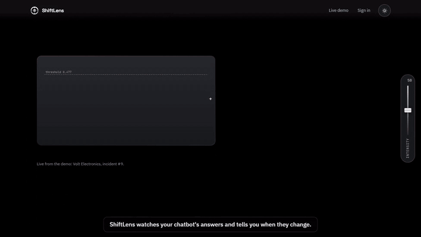

# ShiftLens

**Your chatbot changed and nobody told you.**

ShiftLens watches every answer your chatbot gives, learns what normal looks like for *your*
bot, and when the answers drift it opens one incident and sends one Slack message: what
changed, probably why, and the request ids that prove it.



The 80-second version (incident, a question, and a try without code) is in "How it works" on the site.

- **Site:** https://shiftlens.pages.dev/
- **Live demo (no sign-up):** https://shiftlens.pages.dev/app/demo/ —
  Volt Electronics, a fictional support bot fed by real fixture traffic
- **App:** https://shiftlens.pages.dev/app/
- **Backup copy of the site:** https://kinjalgoswami68.github.io/ShiftLens/ (same build, GitHub Pages)
- **API:** `https://sentinelai-qqph.onrender.com` ([docs/API.md](docs/API.md))

## Try it without code

Paste or upload answers from your bot (CSV or JSON, a "before" group and an "after" group) at
[/app/#/try](https://shiftlens.pages.dev/app/#/try). It runs the same detection
and investigation as the live service and shows the note. Nothing is stored.

## Ask about an incident

Every incident page (and the demo) has a box for questions. An agent answers using the
investigation's tools and has to cite real request ids for every claim; claims it can't back up
are dropped. Free tier: 15 questions a day in total.

## Install

No sign-up step:

```bash
pip install "git+https://github.com/KinjalGoswami68/ShiftLens.git#subdirectory=sdk"
```

```python
import shiftlens
shiftlens.auto()      # tracks every OpenAI / Groq chat completion; no key needed
```

The first run registers a bot, saves its key in `~/.shiftlens/config.json` and prints the
dashboard link. Other clients: `shiftlens.track(question, answer, prompt_version="v3",
context=docs)`. Send `prompt_version` / `model_version` if you have them: they turn "something
changed" into "prompt v3 changed it". It never slows or breaks the bot. No client? It's one HTTP
call — see [docs/API.md](docs/API.md).

## How it works

1. **Detect (math, no LLM, no cost per answer).** Each answer is embedded with
   `bge-small-en-v1.5` and compared with the bot's own normal answers: distance to the 5th
   nearest neighbour against a learned threshold, plus two CUSUMs (answers drifting away;
   refusals and empty answers rising) and a group check when a new `prompt_version` or
   `model_version` shows up.
2. **Learn first.** A new bot is `learning` (under 30 answers), then `provisional` (flags on
   the dashboard only), then `ready` once the threshold is stable and traffic spans 2 hours.
   Slack and investigations only start at `ready`.
3. **Investigate.** When an incident opens, code tools compare the numbers, cluster the
   changed answers, line up version changes and look for similar past incidents. Then one LLM
   call (Groq `openai/gpt-oss-120b`, free tier) writes the note. Every claim must cite an
   evidence id, invented ids are dropped, and the LLM can lower the confidence the rules
   computed but never raise it. If Groq is unavailable you get a rules-only note.
4. **Alert.** Signals become one incident with at most 3 Slack messages: opened (with the
   note), escalated, resolved. It resolves after 30 quiet minutes.

### From the first answer

The detector needs a baseline, but some problems don't:

- **Day-1 checks (no LLM):** empty answers, refusals, error text, repetition, garbled text,
  wrong language, answers unrelated to the question. A high rate in 30 minutes opens an incident
  even while the bot is learning.
- **Spot-checks:** a sample of answers (at most 30 per bot a day) is judged by an open model on
  Groq's free tier (`qwen3.8-27b`): does it answer the question, and if you pass `context=`,
  is it supported by your documents? The context is used for the check and never stored.
- **Baseline review:** when the bot becomes ready, the answers it learned from are checked once
  ("12% of them are refusals. Intended?"), so a bad start isn't silently learned as normal.
- **Daily digest** at 20:30 IST, and **your own Slack channel** per bot (`POST /bot/slack`).
  Without one, a bot is dashboard-only.
- **Import history:** `shiftlens.import_history(pairs)` builds the baseline from past logs (300
  a day) instead of waiting for traffic.

## Scorecard

8 scripted scenarios replayed through the production code (300 normal answers, then 100
changed ones): **cause named right 7 of 8, 0 false incidents on normal traffic, a prompt change
caught after 10 answers**. The miss: a topic shift was caught after 4 answers but the note said
"unknown". One seed, so read these as single runs, not rates.
Full table, including what didn't work: [docs/SCORECARD.md](docs/SCORECARD.md).

Day-1 checks on the same fixtures: fluent off-topic answers (questions paired with the wrong
answers) caught after 12 answers with 0 flags on normal ones; a bot deflecting 20% of the time
from day 1 gets asked about it in its baseline review. Spot-checks with context catch changed
facts (19 of 19) but also flag most unchanged answers as "partly supported", so read them as
"check this", not as a verdict.

Per-answer false positives on ordinary answers went from 5 of 60 (the first TF-IDF +
Isolation Forest version) to 1 of 60: [docs/detection_scorecard.md](docs/detection_scorecard.md).

## Architecture

```text
your bot ──track()──▶ FastAPI on Render (free, Singapore)
                        ├─ embed (FastEmbed, bge-small int8 ONNX, ~0.8 s, in process)
                        ├─ kNN threshold + CUSUMs + version check   (detector.py, learning.py)
                        ├─ incident state machine                   (incidents.py)
                        ├─ investigation: tools + rules + 1 Groq call (investigation.py)
                        └─ Slack webhook (max 3 messages per incident)
                      Supabase Postgres (free, session pooler, 15 connections)
static site + app ◀── Cloudflare Pages, GitHub Pages as backup (Vite, React, Tailwind, GSAP on the landing only)
```

- Everything runs on free tiers, with no card anywhere. Hitting a limit degrades instead of
  billing: Groq 429 falls back to a rules-only note, and the server sleeps outside
  09:00–21:00 IST (kept awake inside it by cron-job.org).
- Memory on Render: ~320 MB of 512 MB.
- CI (GitHub Actions): every deploy is checked against the live API; the site is built,
  scanned for secrets and measured with Lighthouse on both addresses after each deploy.
- Design notes per component: [docs/](docs/).

## Limits

- **It doesn't detect hallucinations.** It notices when answers *change*, not whether a single
  answer is true. Built to catch when your bot's behaviour changes, not to fact-check answers.
- **On-topic changes without version metadata are hard.** If your bot doesn't send
  `prompt_version` or `model_version`, a subtle change often only gets "something changed".
- **A change during learning is learned as normal.** The first answers become the baseline,
  mistakes included. Measured in the scorecard: a prompt change after 20 answers was absorbed
  with or without version metadata. The baseline review now points out refusals and off-topic
  answers in what it learned, but a different-but-fluent style is still learned silently.
- **Spot-checks are a sample, and noisy.** At most 30 answers per bot a day, judged by a small
  open model. They say "likely", never "wrong", and with context they over-flag.
- **A topic it never saw while learning gets flagged.** That is a real change for the bot, but
  maybe one you expected (it happened to the demo bot: its fixture was posted grouped by topic).
- **Free tier, so it's slow to wake.** Outside 09:00–21:00 IST the API sleeps and the first
  request takes about a minute.
- **Caps.** One investigation per bot per 30 minutes and 20 per day in total (Groq free:
  200K tokens/day). Registration: 5 per IP per hour, 50 per day; bots with 0 answers after 7
  days are deleted.
- **English only.** The embedding model is English; Hinglish answers are not evaluated yet.
- **Small evidence.** The scorecard is one seed of generated fixtures, and the demo bot is
  fictional. Real traffic is the next test — see below.

## Try it on your bot

Have a bot with real traffic? Send me 50 answers (anonymised) and I'll send back what it finds:
[open an issue](https://github.com/KinjalGoswami68/ShiftLens/issues/new?title=50+answers).
Issues are public, so never paste customer data or keys.

## Run locally

```bash
pip install -r requirements.txt          # Python 3.14 (.python-version)
python scripts/fetch_model.py            # downloads the embedding model once
# .env: DATABASE_URL (Postgres), optional SLACK_WEBHOOK_URL, GROQ_API_KEY
CORS_ORIGINS=http://localhost:5173 python -m uvicorn main:app --port 8000
cd web && npm ci && VITE_API_BASE=http://127.0.0.1:8000 npm run dev    # site + app on :5173
```

Tests: `python -m unittest discover -s tests`. Live end-to-end check: `python test_real.py`.

## Licence

MIT. Built by Kinjal Goswami.
